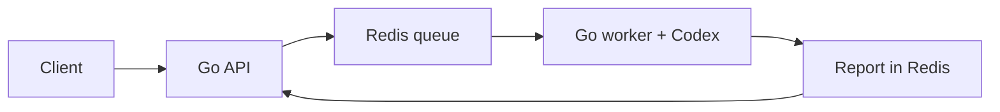

# Research agents on Hetzner

A small Go API and research worker on your own k3s cluster. Workers use the official Codex CLI with your ChatGPT subscription.



KEDA starts worker pods when jobs arrive. Cluster Autoscaler adds Hetzner VMs when those pods need capacity. Idle workers and their VMs scale back to zero.

## Use

From this directory:

```bash
export KUBECONFIG="$PWD/.state/kubeconfig"
kubectl -n research port-forward service/research-api 8080:80
```

In another terminal:

```bash
source .env
curl localhost:8080/v1/research \
  -H "Authorization: Bearer $API_TOKEN" \
  -H 'Content-Type: application/json' \
  -d '{"query":"Explain Kubernetes node autoscaling using primary sources"}'

curl localhost:8080/v1/research/JOB_ID \
  -H "Authorization: Bearer $API_TOKEN"
```

The first job can take several minutes while a worker VM boots.

## Update

```bash
./scripts/publish-image.sh demo-2
./scripts/deploy.sh demo-2
```

Images build on your system VM and go to your private cluster registry. Use a new tag for each release.

- [Setup](docs/setup.md): provision, authenticate, deploy, operate.
- [Architecture](docs/architecture.md): components, scaling, boundaries.

This is a playground: one control plane, one system VM, local storage, no high availability. All Codex jobs share your subscription limits.
