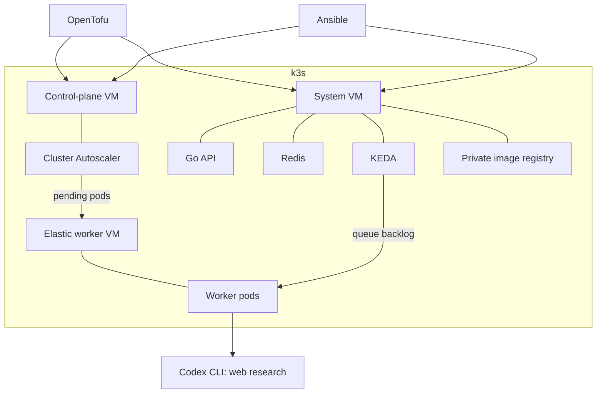

# Architecture

| Component | Owns |
|---|---|
| OpenTofu | Network, firewall, SSH key, two baseline VMs |
| Ansible | k3s installation and configuration |
| Hetzner cloud controller | Kubernetes node identity and networking integration |
| Cluster Autoscaler | Zero to two elastic worker VMs |
| KEDA | Zero to two worker pods |
| Go worker | One concurrent Codex research job per pod |

## A job

1. The API authenticates the request, stores a job, and returns its ID.
2. Redis Streams queues the job.
3. KEDA requests worker pods. Cluster Autoscaler creates a VM if needed.
4. A Go worker consumes the job and runs `codex exec` with web search.
5. The worker stores the report in Redis. The client polls the API for it.
6. After idle cooldowns, worker pods and elastic VMs are removed.

## Isolation

System services stay on the fixed system VM. Labels and taints reserve elastic VMs for research. Each Codex run gets a temporary workspace and a read-only command sandbox, with shell tools disabled.

SSH and the Kubernetes API are restricted to operator CIDRs. Redis and the image registry are private. Baseline VMs remain running when there are no jobs.

## Playground limits

- All workers share one Codex subscription's usage limits.
- Redis uses temporary storage; replacing its pod loses jobs and reports.
- A worker crash can leave a job pending; resubmit it in this minimal demo.
- No public ingress, high availability, or automatic login refresh distribution.

The directory and Go module retain the original `adk-research` name; the runtime uses Codex.
