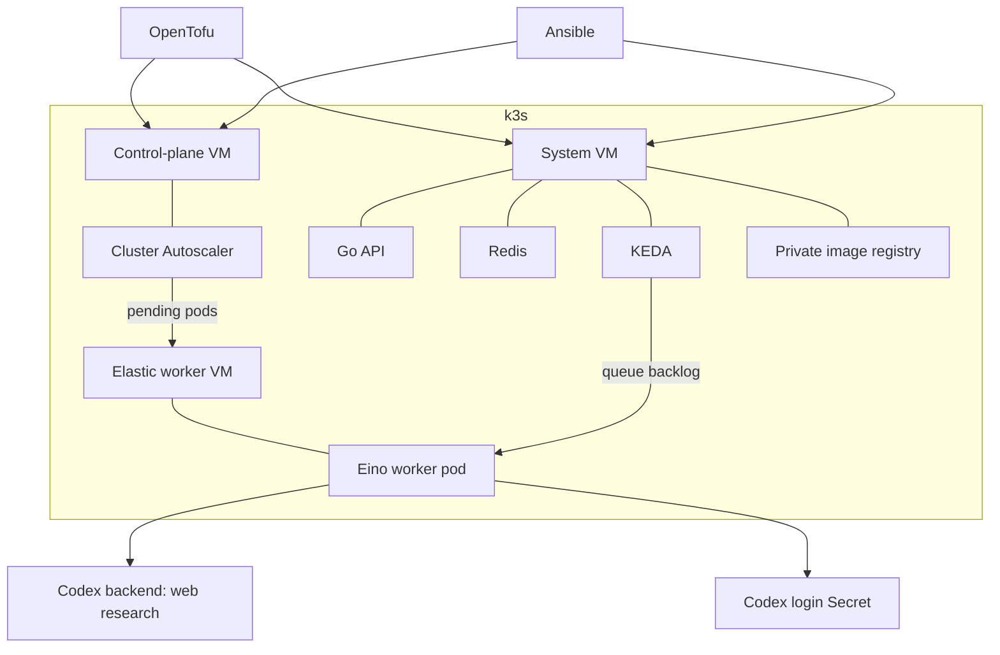

# Architecture

| Component | Owns |
|---|---|
| OpenTofu | Network, firewall, SSH key, two baseline VMs |
| Ansible | k3s installation and configuration |
| Hetzner cloud controller | Kubernetes node identity and networking integration |
| Cluster Autoscaler | Zero to one elastic worker VM |
| KEDA | Zero to one worker pod |
| Go worker | One Eino agent run at a time |

## A job

1. The API authenticates the request, stores a job, and returns its ID.
2. Redis Streams queues the job.
3. KEDA requests worker pods. Cluster Autoscaler creates a VM if needed.
4. The Go worker runs an Eino chat agent whose model adapter streams directly from the Codex backend with web search.
5. The worker stores the report in Redis. The client polls the API for it.
6. After idle cooldowns, worker pods and elastic VMs are removed.

## Isolation

System services stay on the fixed system VM. Labels and taints reserve elastic VMs for research. The worker makes HTTPS model requests; it does not give the model command or file tools.

The worker mounts a writable copy of your file-backed Codex login. It refreshes the ChatGPT OAuth token when needed and saves the new copy to an encrypted Kubernetes Secret for the next pod. Its service account can patch only that Secret. A single active worker avoids concurrent refreshes of the same login.

The direct Codex backend protocol is based on [Pi's implementation](https://github.com/badlogic/pi-mono/tree/main/packages/ai/src). It is not a documented public OpenAI API and can change without notice.

SSH and the Kubernetes API are restricted to operator CIDRs. Redis and the image registry are private. Baseline VMs remain running when there are no jobs.

## Playground limits

- One Codex subscription login supports one active worker in this setup.
- Redis uses temporary storage; replacing its pod loses jobs and reports.
- A worker crash can leave a job pending; resubmit it in this minimal demo.
- No public ingress or high availability.

The directory and Go module retain the original `adk-research` name; the runtime uses Codex.
